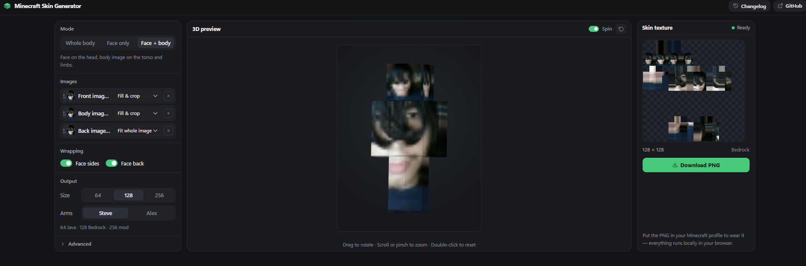

<a id="top"></a>

# SKINGEN — Minecraft Skin Generator

Put a real photo on a Minecraft character. One HTML file, no install, no server, no network:
open it, drop a picture, download a skin. Bedrock Edition takes 128×128 skins,
so a high-resolution photo keeps its detail in game (256×256 needs a skin mod).

**[▶ https://oscar269.github.io/SKINGEN/](https://oscar269.github.io/SKINGEN/)** · [日本語](#日本語)



## What it does

- **Photo → skin.** A front photo is mapped onto the head, torso, arms and legs; the sides, top, bottom and back are derived from it.
- **Works in Java and Bedrock.** Export 64×64 for Java Edition and 128×128 for Bedrock Edition. Verified in-game on both, including on a Bedrock server.
- **3D preview you can spin.** Drag to rotate, wheel / pinch to zoom, double-click to reset. Auto rotate is on by default, and the overlay (second) layer is rendered too.
- **Three modes.** Face + body (default), face only, or one whole-body photo.
- **Per-image Fit.** `contain` / `cover` / `stretch` is set separately for the front, body and back images.
- **Face on sides / Face on back.** Choose whether the face photo wraps around the head or stays on the front.
- **Steve (4 px arms) and Alex (3 px arms)**, pixel-art nearest-neighbour scaling, transparent margins.
- **Ready to upload.** The overlay layer stays transparent, so the PNG can go straight into the game.

## Quick start

1. Open **https://oscar269.github.io/SKINGEN/** (or double-click `index.html`).
2. Drop your **face photo** into *Front image* and your **body / fur photo** into *Body image*.
   (Both boxes are visible in the default `Face + body` mode; for a single full-body photo switch Mode to `Whole body photo`.)
3. Tune each image with its own `contain` / `cover` / `stretch` select, and decide whether the face should appear on the head's sides and back.
4. Pick **Size**: 64×64 for Java, 128×128 for Bedrock.
5. Click **Download skin (PNG)** and upload the file.

## Modes

| Mode | What it does |
| --- | --- |
| **Face + body** *(default)* | Face image on the head, body image on torso, arms and legs. Without a body image the body is painted with a heavily blurred copy of the face |
| Face only | The face is printed on the head, and the blurred copy fills the body |
| Whole body photo | The whole photo is stretched over the entire skin |

## Settings

| Setting | Description |
| --- | --- |
| Front image + Fit | The face (or the whole body) image. Required |
| Body image + Fit | Shown in `Face + body`. Torso, arms and legs |
| Back image + Fit | Optional; a darkened mirror of the front is used when empty |
| Mode | One of the three modes above |
| Size | 64×64 (Java) / 128×128 (Bedrock) / 256×256 (only with a skin mod) |
| Arms (Steve / Alex) | Pick the arm model you use in-game; the arm width is part of the skin format |
| Pixel art | Nearest-neighbour scaling instead of smooth, for pixel-art sources |
| Transparent margins | Keep transparent source pixels transparent; turn it off to fill them with the colour picker value |
| Face on sides / Face on back | Shown in the face modes. On: the face photo is put on the head's sides / back, off: that face is built from the body image |

## Size and edition

| Size | Edition | Notes |
| --- | --- | --- |
| 64×64 | Java Edition (1.8+) | The only size Java accepts |
| 128×128 | Bedrock Edition | Recommended; the size Bedrock servers use |
| 256×256 | Modded Bedrock | The tool can export it, but vanilla Bedrock rejects anything over 128×128 — it needs a custom skin loader / mod |

- Arm width is part of the skin format. If you export with `Slim arms (Alex)` but pick the classic model in-game (or the other way round), the arms sit one pixel off.
- Bedrock takes the same PNG from a server as from single-player, so a 128×128 export looks the same everywhere.

### Applying the skin

- **Java Edition**: Launcher → Skins → New skin → choose the PNG (64×64).
- **Bedrock Edition**: Launcher → Skins, or the in-game character creator → import the PNG (64 / 128; 256 needs a mod).

## 3D preview

- Drag to rotate, wheel or pinch to zoom, double-click (or *Reset view*) to go back to the front.
- *Auto rotate* spins the model slowly.
- The overlay layer of any skin is drawn, so imported skins with jackets, hats or ears look right.
- The preview uses the vanilla face layout, so what you see matches the game.

## How it works

1. The image is fitted into a **16×32** canvas (1 unit = 1 px at 64×64) with its own `Fit`. With `contain`, the padding is filled by stretching the border pixels — invisible padding would punch holes through a leg or the top of the head.
2. Six parts are cropped from it: head `(4,0)-(12,8)`, torso `(4,8)-(12,20)`, right arm `(0,8)-(4,20)`, left arm `(12,8)-(16,20)`, right leg `(4,20)-(8,32)`, left leg `(8,20)-(12,32)`.
3. Each part is written as the unwrapped faces of a box. The front is copied as-is; sides come from one border column (0.85), the top from one border row (1.1), the bottom from one border row (0.6), and the back from the back image or the mirrored, darkened front.
4. In the face modes the head front is cut from the face image, and the sides / back are either the same face (0.85 / mirrored) or the body texture's head.
5. The overlay (second) layer is left transparent, so the PNG uploads as-is.
6. The 3D preview reads the finished texture, builds the player model (base + overlay), and draws it with an orthographic camera.

## Tips and limitations

- Straight-on, evenly lit, full-body photos work best; angled shots and folded arms break the mapping.
- Backgrounds are not removed. A pre-cut transparent PNG gives the cleanest result.
- The sides and back only contain border colours when you use a single front photo — they are a plausible guess, not real detail.
- For a face photo, a square, closely cropped face works best.
- 64×64 loses fine detail; build at 128×128 for Bedrock if you care about it.

## Troubleshooting

| Symptom | Fix |
| --- | --- |
| Nothing shows up, Download stays disabled | Load a Front image first |
| The skin is transparent or black | The source is a transparent PNG — turn off `Transparent margins` and pick a colour |
| Everything looks blurry | Turn on `Pixel art`, or use a larger source |
| Arms are shifted by a pixel | The `Arms` setting must match the model you select in-game |
| A leg or the top of the head looks cut | Try `cover` for that image's Fit |
| The face is not on the sides of the head | Turn on `Face on sides` |
| The back looks like the front | The back image is mirrored on purpose; use a photo taken from behind |
| Weird bands of colour | Change that image's Fit from `stretch` to `contain` or `cover` |
| Drag & drop does nothing on mobile | Tap the box and pick a file instead |

## Changelog

The same list is inside the tool (the **Changelog** button, top right).

### 2026-11-21

- Redesigned the interface: an equal-height three-column editor with compact one-row upload slots, segmented controls and switches
- 3D preview: drag to spin, wheel / pinch to zoom, auto rotate, overlay layers
- Fit is set per image (front / body / back)
- Face wrapping split into `Face on sides` and `Face on back`; the head's sides now get the face itself
- Face + body is the default mode
- Fix: `contain` left transparent holes in the legs and the top of the head
- Fix: the slim (Alex) arm's bottom face was one pixel off
- Fix: `Face on back` did nothing when a back image was set

### 2026-11-18

- Fix back-face mirroring, blank side faces and the blurry head
- Face + body mode with separate face and body images
- Bilingual README, browser-only generator (64 / 128 / 256)

## Files

```
SKINGEN/
├── index.html   # the whole tool
├── image.png    # screenshot used above
└── README.md
```

## License

No license has been specified for this repository yet.

[↑ Back to top](#top)

---

<a id="ja"></a>

# 日本語

写真をそのまま Minecraft のキャラクターに。`index.html` を開くだけで動き、インストールもサーバもネット接続も要りません。
Bedrock は 128×128 なので、**高画質な写真の細部をそのままスキンにできます**（256×256 は mod が必要）。

**[▶ https://oscar269.github.io/SKINGEN/](https://oscar269.github.io/SKINGEN/)** · [English](#top)


## できること

- **写真からスキンへ。** 正面の写真を頭・胴・腕・脚に貼り、側面・上下・背面はそこから作ります。
- **Java でも Bedrock でも動く。** Java 用に 64×64、Bedrock 用に 128×128 を書き出せます。実機の Java、そして Bedrock のサーバー上でも 128×128 のスキンで動作確認済みです。
- **ぐるぐる回せる3Dプレビュー。** ドラッグで回転、ホイール / ピンチで拡大、ダブルクリックで正面に戻ります。自動回転は既定でオン。重ね着レイヤーも描画します。
- **モードは3つ。** 顔＋体（既定）、顔だけ、全身写真。
- **画像ごとの Fit。** 前面・体・背面それぞれに `contain` / `cover` / `stretch` を指定できます。
- **顔を側面・背面に回すか選べる。** `Face on sides` / `Face on back`。
- **Steve（腕4px）と Alex（腕3px）**、ドット絵向けの最近傍補間、透明余白。
- **そのままアップロード可能。** 重ね着レイヤーは透明のまま出力します。

## 使い方

1. **https://oscar269.github.io/SKINGEN/** を開くか、`index.html` をダブルクリックします。
2. **Front image** に顔写真、**Body image** に体（毛並みなど）の写真をドロップします。
   （既定の `Face + body` では両方の枠が出ます。1枚の全身写真だけで作るなら Mode を `Whole body photo` に。）
3. 画像ごとの `contain` / `cover` / `stretch` を調整し、顔を頭の側面・背面に回すかを決めます。
4. **Size** を選びます（Java は 64×64、Bedrock は 128×128）。
5. **Download skin (PNG)** を押して保存し、ゲームに読み込みます。

## モード

| モード | 動作 |
| --- | --- |
| **Face + body**（既定） | 顔画像を頭に、体画像を胴・腕・脚に。体画像が無いときは顔を強くぼかした色で体を塗ります |
| Face only | 頭の前面に顔、体は顔をぼかした色 |
| Whole body photo | 写真全体をスキン全体に引き伸ばして貼る |

## 設定項目

| 項目 | 説明 |
| --- | --- |
| Front image + Fit | 顔（または全身）の画像。必須 |
| Body image + Fit | `Face + body` のとき表示。胴・腕・脚 |
| Back image + Fit | 任意。未指定なら正面を左右反転して暗くしたもの |
| Mode | 上の3モード |
| Size | 64×64（Java）/ 128×128（Bedrock）/ 256×256（mod 必須） |
| Arms (Steve / Alex) | ゲームで使う腕のモデルを選択。腕の太さはスキン形式の一部です |
| Pixel art | 縮小時に補間せず最近傍で縮小（ドット絵向け） |
| Transparent margins | 元画像の透過部分を透明のまま残す。オフにするとカラーピッカーの色で塗る |
| Face on sides / Face on back | 顔モードのみ表示。オンで顔画像を頭の側面 / 背面に、オフでその面を体画像から作る |

## サイズとエディション

| サイズ | 向き | 備考 |
| --- | --- | --- |
| 64×64 | Java Edition（1.8 以降） | Java が受け付ける唯一のサイズ |
| 128×128 | Bedrock Edition | 推奨。Bedrock のサーバーでもこのサイズ |
| 256×256 | Bedrock（mod 必須） | 書き出しはできますが、バニラの Bedrock は 128×128 より大きいスキンを読み込みません。カスタムスキン用の mod / ローダーが必要です |

- 腕の太さはスキン形式の一部です。`Slim arms (Alex)` で出力したのにゲーム側でクラシック（Steve）を選ぶと、腕が 1px ずれます。逆も同じです。
- Bedrock はサーバーでも同じ PNG をそのまま使うので、128×128 の見た目はどこでも同じになります。

### 適用方法

- **Java Edition**: ランチャー → Skins → New skin → PNG を選択（64×64）
- **Bedrock Edition**: ランチャーのスキン画面、またはゲーム内のキャラクター作成から PNG をインポート（64 / 128。256 は mod が必要）

## 3Dプレビュー

- ドラッグで回転、ホイール / ピンチで拡大、ダブルクリック（または *Reset view*）で正面へ。
- *Auto rotate* でゆっくり自動回転。
- 重ね着レイヤーも描画するので、上着・帽子・耳などが付いた既存スキンも正しく見えます。
- バニラの面の割り当てで描いているので、ゲーム内の見た目と一致します。

## 仕組み

1. 画像を **16×32**（1 マス = 64×64 で 1px）のキャンバスに、その画像の `Fit` で収めます。`contain` で余白が出る場合は端の 1px を引き伸ばして埋めます（透明な余白は脚や頭に穴が空いてしまうため）。
2. そこから6部位を切り出します: 頭 `(4,0)-(12,8)`、胴 `(4,8)-(12,20)`、右腕 `(0,8)-(4,20)`、左腕 `(12,8)-(16,20)`、右脚 `(4,20)-(8,32)`、左脚 `(8,20)-(12,32)`。
3. 各部位を直方体の展開図として書き込みます。前面はそのまま、側面は端の 1 列（0.85）、上面は端の 1 行（1.1）、底面は端の 1 行（0.6）、背面は背面画像か、正面を反転して暗くしたもの。
4. 顔モードでは頭の前面を顔画像から切り出し、側面・背面は同じ顔（0.85 / 反転）か、体画像の頭部分から作ります。
5. 重ね着レイヤーは透明のままなので、そのままアップロードできます。
6. 3Dプレビューは完成したテクスチャを読み、プレイヤーモデル（ベース＋重ね着）を組んで平行投影で描画します。

## コツと制限

- 正面・全身・均一な照明の写真が一番きれいに出ます。斜め向きや腕を組んだポーズは崩れます。
- 背景は除去しません。切り抜き済みの透過 PNG を使うと余計な色が入りません。
- 正面写真1枚だけの場合、側面・背面は端の色を引き伸ばした「それらしい」推測です。
- 顔写真は、正方形に近く顔が大きく写っているものほど良い結果になります。
- 64×64 は細部が潰れます。細かさが欲しいなら Bedrock 向けに 128×128 で。

## トラブルシューティング

| 症状 | 対処 |
| --- | --- |
| 何も表示されない / Download が押せない | まず Front image に画像を入れる |
| スキンが真っ透明 / 真っ黒 | 元画像が透過 PNG。`Transparent margins` をオフにして色を指定する |
| 全体的にぼやける | `Pixel art` をオンにする、または元画像を大きくする |
| 腕が 1px ずれる | `Arms` の設定とゲーム側のモデルを一致させる |
| 脚や頭の上が欠けて見える | その画像の Fit を `cover` にしてみる |
| 頭の側面に顔が無い | `Face on sides` をオンにする |
| 背中が正面と同じに見える | 背面は仕様どおり反転。後ろから撮った写真を `Back image` に入れる |
| 色が縞になる | その画像の Fit を `stretch` から `contain` / `cover` に変える |
| スマホでドラッグできない | 枠をタップしてファイル選択から指定する |

## 変更履歴

ツール右上の **Changelog** ボタンからも見られます。

### 2026-11-21

- UI を刷新: 高さの揃った3カラム、1行型のアップロード欄、セグメントコントロール
- 3Dプレビュー（ドラッグで回転、ホイール / ピンチで拡大、自動回転、重ね着レイヤー対応）
- Fit を画像ごとに分離（前面 / 体 / 背面）
- 顔の回り込みを `Face on sides` / `Face on back` に分割。側面には顔そのものを貼るように
- 既定モードを `Face + body` に変更
- 修正: `contain` で脚と頭の上に透明な穴が空いていた
- 修正: Alex（細腕）の腕の底面が 1px ずれていた
- 修正: 背面画像があると `Face on back` が効かなかった

### 2026-11-18

- 背面の左右反転、側面が空になる問題、頭がぼける問題を修正
- 顔と体を別画像で指定する `Face + body` モード
- 日本語 / 英語 README、ブラウザだけで動く生成ツール（64 / 128 / 256）

## ファイル構成

```
SKINGEN/
├── index.html   # ツール本体
├── image.png    # 上のスクリーンショット
└── README.md
```

## ライセンス

このリポジトリにはまだライセンスが設定されていません。

[↑ 先頭へ](#top)
